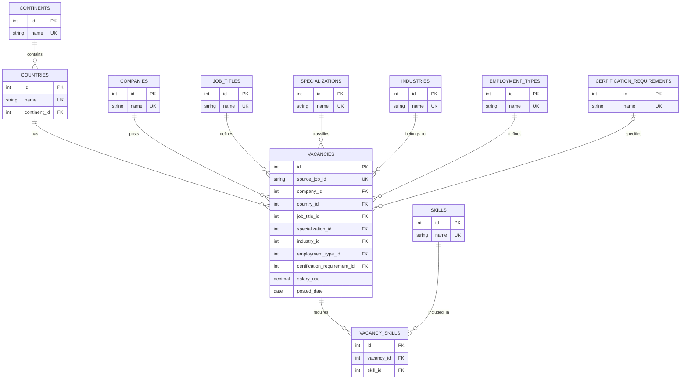

# ER-диаграмма базы данных

База данных состоит из 11 таблиц. Справочники хранят повторно используемые значения, таблица `vacancies` содержит
сведения о вакансиях, а `vacancy_skills` реализует связь многие-ко-многим между вакансиями и навыками.

