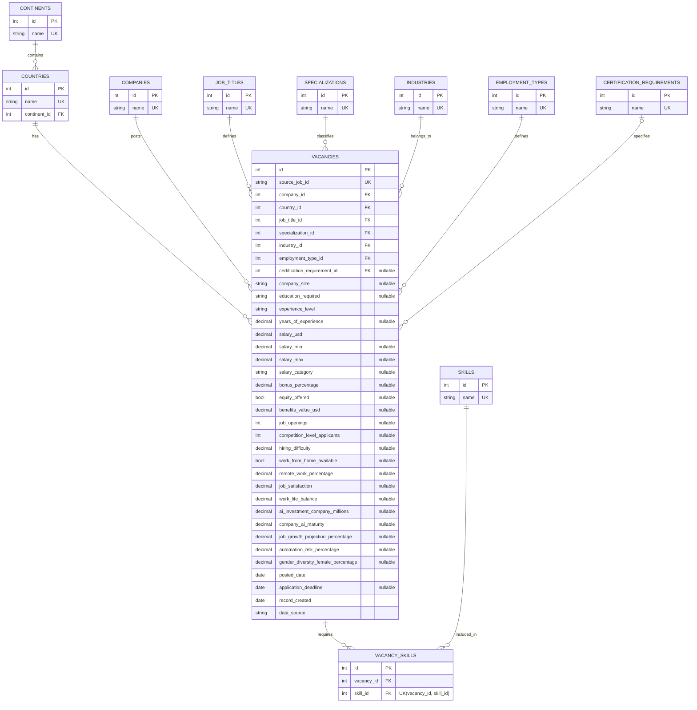

# ER-диаграмма базы данных

База данных включает 11 связанных таблиц: справочники, основную таблицу `vacancies` и ассоциативную таблицу `vacancy_skills` (связь «многие-ко-многим» между вакансиями и навыками). Схема создаётся и изменяется через миграции Alembic.

## Краткое описание

- **Связи 1:N**: `continents→countries`, справочники (company, country, job_title, specialization, industry, employment_type, certification_requirement) → `vacancies`.
- **Связь M:N**: `vacancies ↔ skills` через `vacancy_skills` (уникальная пара вакансия-навык, каскадное удаление).
- **Ограничения целостности**: PK/FK, `UNIQUE` (`source_job_id`, имена справочников, пары в `vacancy_skills`), `NOT NULL` для ключевых полей, `CHECK` (диапазоны зарплат/процентов/рейтингов, неотрицательные значения, дедлайн не раньше публикации).
- **Индексы**: внешние ключи и часто используемые поля поиска/фильтрации индексируются миграциями.
